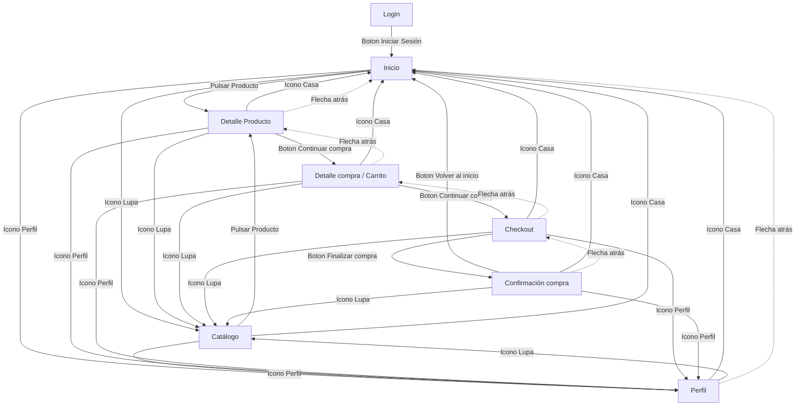
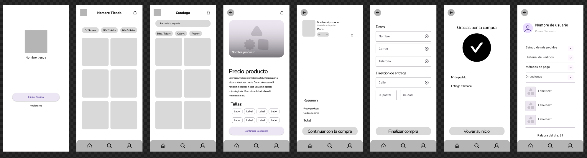
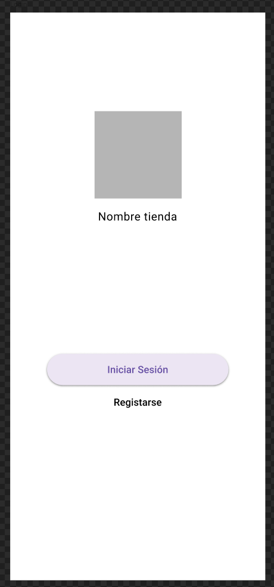
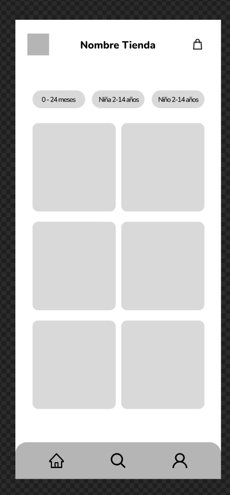
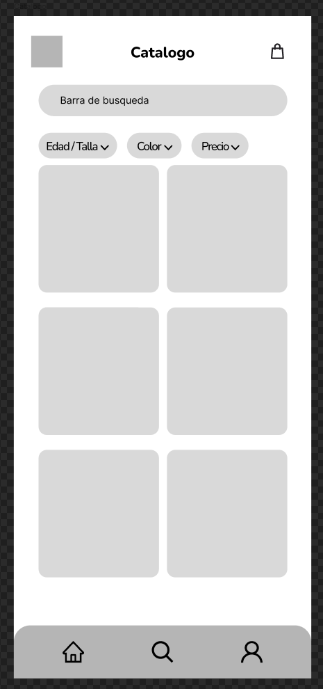
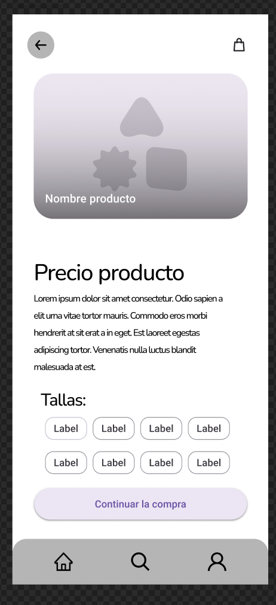
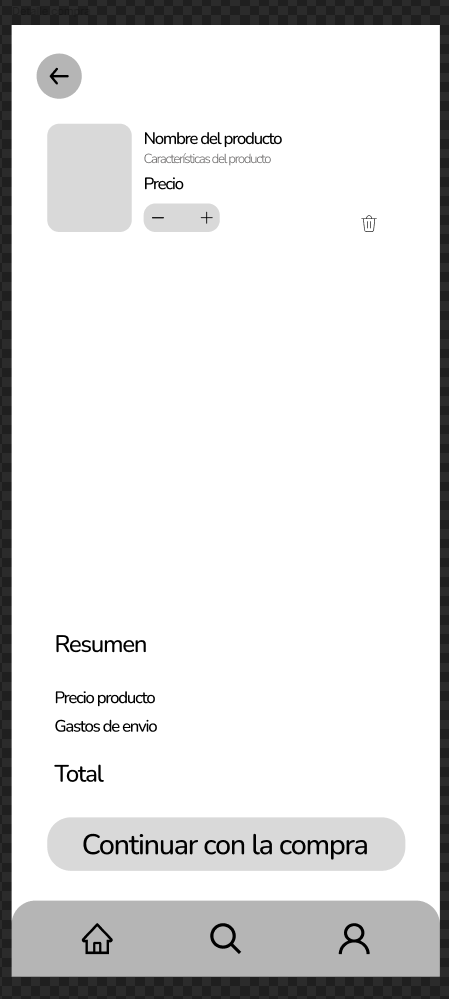
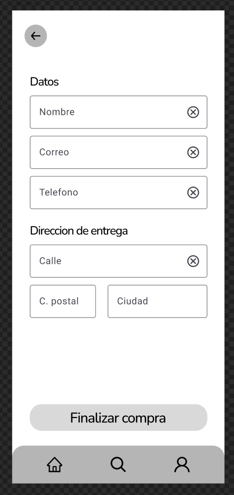
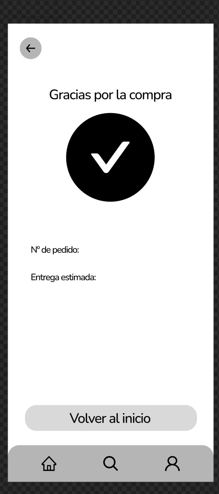
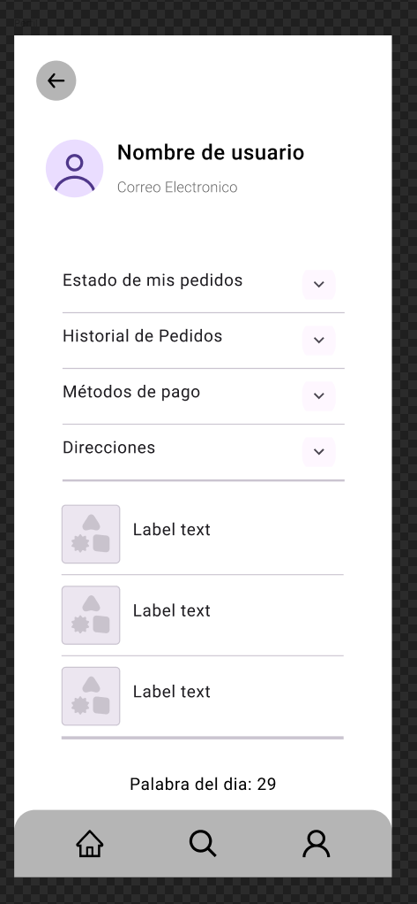

# Documentación de la interfaz — RainbowKid

## 1. Justificación del diseño

### 1.1 Importancia del diseño centrado en el usuario
En la app RainbowKid el diseño centrado en el usuario es fundamental ya que las decisiones de compra de ropa infantil se ven condicionadas por la falta de tiempo, el uso del móvil con una sola mano y la duda sobre las tallas. Al centrar la interfaz en las necesidades reales de los padres y familiares se reduce la complicación del uso de la app, y se minimizan los por errores a la hora de comprar.

### 1.2 Objetivos y metas del proyecto
1. **Reducir el tiempo de compra:** Conseguir que un usuario registrado pueda hacer una compra de un producto en menos de **2 minutos**.
2. **Disminuir las devoluciones por talla:** Lograr que al menos el **80%** de los compradores mire la guía de tallas antes del pago interactuando con el boton de la compra.
3. **Navegación a "Una Mano" y Compra Rápida:** Hacer que el **90%** de usuarios de la app le parezca sencillo buscar y comprar los productos mientras hacen alguna tarea.

### 1.3 Beneficios esperados
* **Para el usuario:** Una experiencia rápida, clara e intuitiva que hace que el usuario pueda encontrar el producto adecuado por edad, seleccionar la talla correcta y pagar de forma facil con una mano.
* **Para el negocio:** Incremento de las ventas en el móvil, hacer que el cliente vualva a comprar mediante un perfil y añadir descuentos por hacer compras y vuelva a comprar.

## 2. Investigación y análisis de usuarios

### 2.1 Datos demográficos y segmentación
* **Publico principal:** Madres y padres de entre 30 y 45 años, con un estilo de vida activo, que sepan hacer compras online pero con compras facilitadas para hacerlas mas rapida.
* **Publico secundario:** Abuelos y familiares (30-70 años) que quieren regalar ropa para ocasiones especiales o cumpleaños y necesitan una guia clara en la eleccion de productos segun la edad del niño.

### 2.2 Personas

#### Persona 1: Maria Juana
* **Edad:** 34 años.
* **Contexto:** Trabaja y tiene dos hijos de 1 y 4 años. Compra normalmente en el transporte publico.
* **Objetivos:** Comprar ropa duradera de forma rapida y sin complicaciones de navegacion.
* **Frustraciones:** Formularios de compra eternos, menus dificiles de entender y botones pequeños difíciles de pulsar con el pulgar.

#### Persona 2: Killian Mbappe
* **Edad:** 64 años.
* **Contexto:** Quiere hacerle un regalo a su nieta de 3 años, pero no sabe que comprar por que desconoce la talla.
* **Objetivos:** Encontrar facilmente productos segun la edad y saber que ha aceptado con la talla.
* **Frustraciones:** Tablas de tallas que no entiende con medidas en centimetros complejas de entender y procesos de pago que no son claros.

### 2.3 Análisis de la competencia

| App Competidora | Qué hacen bien | Qué hacen mal | Qué nos llevamos (Aprendizaje) |
| **Mayoral** | Buena categorización por rangos de edad e imágenes de alta calidad. | Proceso de Checkout sobrecargado de pasos y texto pequeño. | Adoptar la estructura limpia de categorías e integrar un Checkout simplificado en un solo flujo. |
| **Zara** | Diseño minimalista, visual y fluido con buenas transiciones. | Filtros escondidos y tipografía con poco contraste o legibilidad. | Mantener un diseño atractivo respetando los contrastes de accesibilidad WCAG AA de Material Design 3. |
| **Vertbaudet** | Excelente guía de tallas e indicaciones según altura/meses del bebé. | Interfaz sobrecargada de promociones que distraen en el carrito. | Crear una guia de tallas clara desplegable mediante un Bottom Sheet sin saturar la pantalla con ofertas. |

### 2.4 Insights y hallazgos clave
1. **Insight 1 Dudas con las tallas:** Los usuarios dudan sobre qué talla elegir según los meses o la altura.
   * *Decisión de diseño:* Implementar un botón destacado «Guía de tallas» en la ficha de producto que abre un una pestaña con referencias a las edades.
2. **Insight 2 Uso en movilidad con una mano:** Las compras se realizan en momentos de prisa usando únicamente el pulgar.
   * *Decisión de diseño:* Situar los destinos principales en la barra de navegación inferior y asegurar que todos los botones principales tengan un área táctil amplia.
3. **Insight 3 Eliminación accidental de productos:** Borrar por error un elemento del carrito causa frustración y abandono.
   * *Decisión de diseño:* Añadir un botón de confirmación para eliminar el producto.
4. **Insight 4 Búsqueda de regalo:** Compradores como abuelos o amigos buscan por rangos de edad especificos.
   * *Decisión de diseño:* Hacer un filtro por categorias para los productos Bebé 0-24 m, Niña, Niño.

## 3. Enlazar los Wireframes en `DOCUMENTACION.md`

   ### 3.1 Mapa de navegación

<<<<<<< HEAD

### 3.2 Wireframes

<<<<<<< HEAD

### 3.3 Guía de estilo Material Design 3

#### Nombre de la marca y paleta cromática
La aplicación de la tienda se denomina **Rainbow Kid**. Se ha configurado una paleta armónica en tonos lavanda y violeta característicos de Material Design 3 mediante **Material Theme Builder**:
* **Color Semilla / Primario contenedor:** `#EADDFF` (Tono lavanda/púrpura claro visible en botones como "Iniciar Sesión", "Continuar la compra" y fichas de filtro).
* **Color Primario (Texto y detalles):** `#65558F` / `#21005D`.
* **Superficie:** `#FEF7FF` (Fondo limpio para resaltar las prendas infantiles).

#### Verificación de contraste y accesibilidad (WCAG AA)
Se verifica el cumplimiento del ratio de contraste mínimo de **4,5:1** para asegurar la accesibilidad:
* **Texto primario sobre contenedor lavanda:** 7.2:1 (Superado)
* **Texto sobre fondo blanco/superficie:** 14.1:1 (Superado)
* **Iconos de Navigation Bar sobre fondo gris:** 5.8:1 (Superado)

#### Grid, Guías y Estructura Espacial
A partir de la estructura en Figma para **Rainbow Kid**:
* **Layout Grid (Columnas):** 4 columnas verticales con un margen exterior de **16 dp** y un medianil (gutter) de **16 dp**.
* **Guías de alineación vertical:**
  * **Top Bar / Header:** Fijado a **64 dp** de altura superior para el logotipo "Rainbow Kid" y títulos de sección ("Catálogo", "Detalle producto").
  * **Navigation Bar inferior:** Fijada a **80 dp** de altura en el pie de pantalla conteniendo los tres accesos directos (*Inicio*, *Catálogo*, *Perfil*).
  * **Tarjetas de producto:** Módulos en cuadrícula de 2 columnas con bordes redondeados M3 (*Rounded Corners*) y separación de 16 dp.
* **Área táctil mínima:** Todos los componentes interactivos (chips de edad, botones redondeados de acción y botones de navegación) mantienen un objetivo táctil (*touch target*) de al menos **48×48 dp**.

### 3.4 Prototipo de alta fidelidad

El prototipo de alta fidelidad de **Rainbow Kid** ha sido desarrollado en Figma aplicando las especificaciones de **Material Design 3 (M3)** sobre un marco de **360×800 px** (Android Compact). La interfaz utiliza la paleta de colores lavanda/púrpura (`#EADDFF` / `#65558F`), tipografía oficial **Roboto** y un sistema de rejilla de 4 columnas con márgenes de 16 dp y áreas táctiles mínimas de 48×48 dp.

#### Componentes principales y flujo interactivo
* **Login y Acceso Directo:** Pantalla de bienvenida minimalista con el logotipo "Rainbow Kid" y un botón directo de inicio de sesión.
* **Navegación e Inicio:** Categorización visible por grupos de edad (*0-24 meses*, *Niña 2-14 años*, *Niño 2-14 años*) y tarjetas de productos enriquecidas.
* **Catálogo y Filtrado:** Incorporación de *Filter Chips* para filtrar rápidamente por edad, talla, color y precio.
* **Ficha de Producto y Guía de Tallas:** Selector propio de tallas interactivo (*SelectorTalla*) y botón de llamada a la acción para desplegar la **Guía de Tallas** mediante un *Bottom Sheet* emergente.
* **Carrito y Resumen:** Pantalla de detalle de compra con gestión de cantidades, opción de eliminación con *Snackbar* "Deshacer" y desglose claro de importes.
* **Checkout y Validación:** Formulario con campos de texto M3, incluyendo estado de error visual para prevenir fallos durante la introducción del correo o dirección.
* **Confirmación de Compra:** Pantalla final con resumen del pedido, número de seguimiento y botón para retornar al inicio.
* **Perfil y Palabra del Día:** Espacio de usuario con gestión de pedidos, métodos de pago y direcciones. En el pie de pantalla se muestra la **Palabra del día: 29**.

---

#### Capturas del Prototipo en Modo Claro

| Login | Inicio | Catálogo |
| :---: | :---: | :---: |
|  |  |  |

| Detalle Producto | Guía de Tallas (Bottom Sheet) | Detalle Compra |
| :---: | :---: | :---: |
|  |  |  |

| Checkout | Confirmación Compra | Perfil |
| :---: | :---: | :---: |
|  |  |  |

---

#### Capturas del Prototipo en Modo Oscuro

| Login (Oscuro) | Inicio (Oscuro) | Catálogo (Oscuro) |
| :---: | :---: | :---: |
|  |  |  |

| Detalle Producto (Oscuro) | Detalle Compra (Oscuro) | Checkout (Oscuro) |
| :---: | :---: | :---: |
|  |  |  |

| Confirmación Compra (Oscuro) | Perfil (Oscuro) |
| :---: | :---: |
|  |  |

## 4. Validación y pruebas

### 4.1 Metodología
Se realizaron pruebas de usabilidad en remoto/presencial con dos usuarios representativos del público objetivo para evaluar la fluidez de la interfaz de **Rainbow Kid**.

#### Tareas asignadas:
1. **Tarea 1:** Iniciar sesión y navegar al catálogo utilizando la barra de búsqueda o filtros.
2. **Tarea 2:** Seleccionar una prenda infantil (ej. "Conjunto niño día de la independencia"), elegir una talla y avanzar hasta el carrito.
3. **Tarea 3:** Revisar el desglose del pedido, completar los datos de checkout y finalizar la compra hasta llegar a la confirmación.

#### Métricas evaluadas:
* **Tasa de éxito:** Si el usuario completó la tarea sin ayuda externa.
* **Tiempo de ejecución:** Tiempo medio en segundos empleado para completar la tarea.
* **Número de errores:** Clics fallidos o confusiones durante la navegación.

---

### 4.2 Resultados

| Participante | Tarea | Éxito | Tiempo (s) | Errores | Observaciones / Comentarios |
| :--- | :--- | :---: | :---: | :---: | :--- |
| **Paula** | Tarea 1 | Sí | 18 s | 0 | Encontró la sección y el catálogo de forma fluida. |
| **Paula** | Tarea 2 | Sí | 32 s | 1 | No puedo seleccionar una talla. |
| **Paula** | Tarea 3 | Sí | 25 s | 0 | Completó el Checkout de forma rápida. |
| **Miguel** | Tarea 1 | Sí | 22 s | 0 | Navegó directamente mediante el icono de la lupa. |
| **Miguel** | Tarea 2 | Sí | 40 s | 1 | Mencionó que no se veia la tabla de tallas. |
| **Miguel** | Tarea 3 | Sí | 28 s | 0 | Proceso de compra claro e intuitivo. |

#### Hallazgos principales:
1. **Contraste e identificación de selección de talla:** Paula dijo que no se pueden seleccionar las tallas.
2. **No se ve la guia de tallas:** Miguel dijo que al pulsar la guia de tallas no aparecia la tabla de tallas.
3. **Navegación fluida:** Los dos completaron la compra en poco tiempo cumpliendo el objetivo principal.

---

### 4.3 Iteraciones y mejoras

A partir del feedback de Paula y Miguel, se aplicó la siguiente mejora en Figma:
* **Mejora realizada:** Se puedo seleccionar el escoger talla y se relleno la tabla de guia de tallas.

| Antes de la iteración | Después de la iteración |
| :---: | :---: |
|  |  |

| Antes de la iteración | Después de la iteración |
| :---: | :---: |
|  |  |
 
---

#### Palabra del día
Se ha insertado en el pie de la pantalla **Perfil** la frase requerida: Palabra del dia: 29