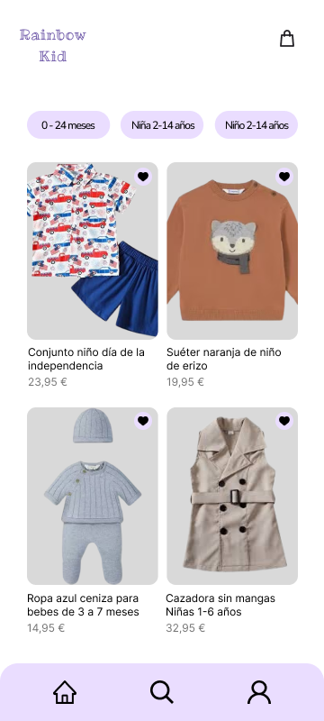

# 🛍️ Rainbow Kid — App Móvil de Ropa Infantil

Bienvenido al repositorio oficial del diseño y prototipo de la aplicación móvil para **Rainbow Kid**, tienda especializada en ropa y calzado infantil de 0 a 14 años. Este proyecto sigue los principios del **Diseño Centrado en el Usuario (DCU)** y las guías de estilo de **Material Design 3 (M3)**.

---

## 📋 Índice
1. [Enlaces a Figma](https://www.figma.com/design/C7uSxcWFbuLkjoIZRmThYu/Sin-t%C3%ADtulo?node-id=24-14322&t=q5BYHConq2zQDlQz-1)
2. [Captura Destacada](#-captura-destacada)
5. [Documentación del Proyecto](DOCUMENTACION.md)

---

## 📸 Captura Destacada

